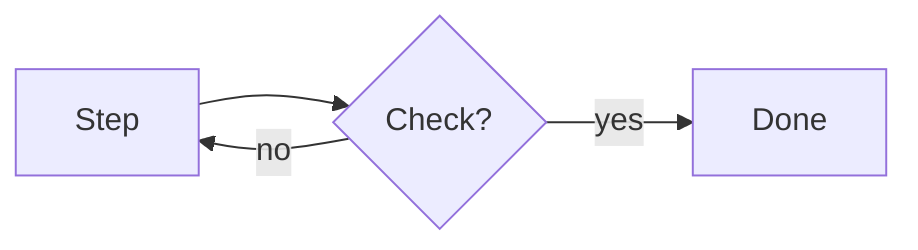

# Doc template

One skeleton, two formats. Sections the context has nothing for are dropped, never left empty.

| | Doc (default) | `--one-pager` |
|---|---|---|
| TL;DR panel | yes | yes |
| Table of contents | when the page has more than 4 `h2` sections | never |
| Length | what the topic needs | a five-minute read, about 1,000 words |
| Diagrams | one per idea | 3 at most |
| What we learned, Sources | full | the strongest 3–5 items each |

Confluence pages open with a metadata header: status, authors, date, reviewers. A GitHub issue keeps that in its assignees and labels, a Markdown file in its git history.

## Rules for every section

- **Lead with the point.** The first sentence of a section states what it shows.
- **240 characters per paragraph at most.** Split longer ones.
- **General before specific.** Rules that hold for every tool or team come first, specifics after.
- **One comparison table, not a section per tool.** Rows are the idea, columns are the tool.
- **Tables over prose** for comparisons and for "Instead of / Do / Why" habits.
- **One idea per diagram**: a loop, or a decision tree. Mermaid, rendered, its source kept with it.
- **Our data carries its caveats**: the sample size, what it doesn't cover, a link to the raw data.
- **Sources are official pages**, grouped by vendor or owner.

## Markdown

GitHub and most Markdown renderers draw a `mermaid` code block, and the raw file is its source, so it needs no expand. A GitHub issue takes the `# Title` as its title and the rest as its body.

````markdown
# {Title: the takeaway or the question it answers}

> **TL;DR.** {The takeaway, one sentence.}
>
> {One or two short paragraphs of context.}
>
> **Ask:** {The decision needed, and from whom. Drop when none.}
>
> **Applies to:** {Tools or teams. Drop when it applies to one.}

## For every {tool | team}

### {Idea 1}

{Point first. Then the why.}



| Instead of | Do | Why |
|---|---|---|
| {habit} | {better habit} | {reason} |

## In each {tool | team}

| | {Tool A} | {Tool B} |
|---|---|---|
| {Idea 1} | {how A does it} | {how B does it} |

## What we learned

- **{Finding, bold.}** {The number, its sample size and its caveat.} {Link to the PR or doc with the raw data.}

## Sources

### {Vendor or owner}

- <{official URL}>
````

## Confluence HTML

The patterns behind each element, and what not to do, are in [confluence.md](confluence.md).

The header is a Page Properties macro, so a Page Properties Report can list every doc's status. Status is `DRAFT` on a new page unless the user names another. Keep the Authors, Date and Status rows, drop a row the context has nothing for, and add rows the topic needs (projects, PRs).

```html
<div data-type="bodied-extension" data-extension-key="details" data-extension-type="com.atlassian.confluence.macro.core" data-parameters='{"macroParams":{},"macroMetadata":{"schemaVersion":{"value":"1"},"title":"Page Properties"}}'>
  <p><em>Statuses: </em><span data-type="status" data-color="neutral" data-status-style="bold">ABANDONED</span> <span data-type="status" data-color="neutral" data-status-style="bold">DRAFT</span> <span data-type="status" data-color="blue" data-status-style="bold">IN PROGRESS</span> <span data-type="status" data-color="yellow" data-status-style="bold">IN REVIEW</span> <span data-type="status" data-color="green" data-status-style="bold">APPROVED</span></p>
  <table>
    <tbody>
      <tr><th><p><strong>Authors</strong></p></th><td><p><span data-type="mention" data-user-id="{AAID}">@{Name}</span></p></td></tr>
      <tr><th><p><strong>Date</strong></p></th><td><p><time datetime="{YYYY-MM-DD}">{Month D, YYYY}</time></p></td></tr>
      <tr><th><p><strong>Status</strong></p></th><td><p><span data-type="status" data-color="neutral" data-status-style="bold">DRAFT</span></p></td></tr>
      <tr><th><p><strong>Reviewers</strong></p></th><td><p>{mentions}</p></td></tr>
      <tr><th><p><strong>Approvers</strong> (comment "LGTM" here)</p></th><td><p>{team or mentions}</p></td></tr>
      <tr><th><p><strong>Related</strong></p></th><td><ul><li><p><a href="{page URL}" data-card-appearance="inline"></a></p></li></ul></td></tr>
      <tr><th><p><strong>Tickets</strong></p></th><td><ul><li><p><a href="{ticket URL}" data-card-appearance="inline"></a></p></li></ul></td></tr>
    </tbody>
  </table>
</div>
<div data-type="panel-info">
  <p><strong>TL;DR.</strong> {The takeaway, one sentence.}</p>
  <p>{One or two short paragraphs of context.}</p>
  <p><strong>Ask:</strong> {The decision needed. Drop when none.}</p>
  <p><strong>Applies to:</strong> {Tools or teams. Drop when one.}</p>
</div>
<div data-type="extension" data-extension-key="toc" data-extension-type="com.atlassian.confluence.macro.core" data-parameters='{"macroParams":{"maxLevel":{"value":"2"}},"macroMetadata":{"schemaVersion":{"value":"1"},"title":"Table of Contents"}}'></div>
<h2>For every {tool | team}</h2>
<h3>{Idea 1}</h3>
<p>{Point first. Then the why.}</p>
<pre><code class="language-mermaid">flowchart LR
  A[Step] --&gt; B{Check?}
  B -- no --&gt; A
  B -- yes --&gt; C[Done]</code></pre>
<table>
  <thead><tr><th><p>Instead of</p></th><th><p>Do</p></th><th><p>Why</p></th></tr></thead>
  <tbody><tr><td><p>{habit}</p></td><td><p>{better habit}</p></td><td><p>{reason}</p></td></tr></tbody>
</table>
<h2>In each {tool | team}</h2>
<table>
  <thead><tr><th><p></p></th><th><p>{Tool A}</p></th><th><p>{Tool B}</p></th></tr></thead>
  <tbody><tr><td><p>{Idea 1}</p></td><td><p>{how A does it}</p></td><td><p>{how B does it}</p></td></tr></tbody>
</table>
<h2>What we learned</h2>
<ul><li><p><strong>{Finding.}</strong> {Number, sample size, caveat.} <a href="{raw data URL}">{PR or doc}</a></p></li></ul>
<h2>Sources</h2>
<h3>{Vendor or owner}</h3>
<ul><li><p><a href="{official URL}" data-card-appearance="inline"></a></p></li></ul>
```

Drop the `toc` extension for `--one-pager` and for pages with 4 `h2` sections or fewer.
