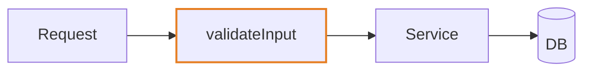

# To PR

Arguments: $ARGUMENTS

- `--safe` — scan the branch for secrets and sensitive data before pushing (step 6).
- `--skip-ci` — mark the pushed HEAD commit `[skip ci]` so CI doesn't run, and skip the CI watch. Only when CI has nothing to check (docs, prose). Required checks then stay pending and block the merge, and a squash merge can carry the marker to the base branch. Say why in the PR body.
- `--diagram[=flow|sequence|class|state]` — make the Summary visual a mermaid diagram. No type → the [Visuals](#visuals) row for the change, else `flow`.

## Workflow

1. `gh auth status`. Not logged in → stop: "Run `! gh auth login`, then `/hb:to-pr` again."
2. In parallel: base branch (`git remote show origin | grep 'HEAD branch'`), ticket id from the branch name (`[A-Z]+-[0-9]+`) or the matching spec's `ticket:` frontmatter, PR template (`.github/pull_request_template.md`, `.github/PULL_REQUEST_TEMPLATE.md`, `.github/PULL_REQUEST_TEMPLATE/`, `docs/pull_request_template.md`, `pull_request_template.md`).
3. In parallel: `git diff <base>...HEAD` and the full commit list — review every commit, not just the latest.
4. **Gate**:
   - Call the Skill tool with `check`. FAIL → report, stop.
   - ADR check: the diff adds a dependency or a module, changes a public API, or adds a migration, and nothing in `docs/adr/` covers it → offer to call the Skill tool with `to-adr` before pushing.
5. Uncommitted work → call the Skill tool with `commit` (never open a PR on a dirty tree).
6. `--safe` → call the Skill tool with `safe-repo`, passing `--diff <base>`. Findings → report each `file:line`, then ask: fix first (Recommended) or push anyway.
7. Push with `-u`. On the default branch → confirm first. Rejected as non-fast-forward → `git pull --rebase`, retry once. **Never force push.**
   - `--skip-ci` → first `git commit --allow-empty -m "chore: [skip ci]"`, so HEAD carries the marker.
8. Draft the title and a concise body from the diff, the commits, and the conversation. Answer every field yourself; never ask the user.
   - Title matches `^(build|chore|ci|docs|feat|fix|perf|refactor|revert|style|test)(\(.*\))?: .+$`.
   - Template found → it is the body, verbatim structure: fill every section and placeholder, check applicable boxes, add nothing outside it. Its summary section carries the visual, its testing section the Evidence, its risk section the Merge Danger. No template → [assets/pr-template.md](assets/pr-template.md), filled the same way.
   - Evidence you can't show → say what wasn't verified. Never invent it.
   - Reference the ticket in the summary (`Resolves TICKET-123`).
9. `gh pr create` with a HEREDOC body. Return the URL.
10. `gh pr checks --watch` (skipped with `--skip-ci`). Red → call the Skill tool with `debug` on the failing check, fix, commit, push. At most 2 rounds; still red → stop and report the failing checks.

Next: `/hb:retro` in this session, before `/clear`.

## Writing the body

**Concise and readable by someone who didn't see the diff.** Each section 1–4 sentences or a short bullet list. Lead with the why, then the what; the diff already shows the how. Use what the user said in the conversation — don't paraphrase the diff back at them. Cut a template section's boilerplate prose only if the template marks it optional; otherwise fill it in one line.

- **Summary**: the why in a sentence or two, then the smallest visual that makes the point ([Visuals](#visuals)). A typo, config, or version-bump-only change needs none.
- **Evidence**: **Before** / **After**. A screenshot for visual changes; otherwise the test run or output that failed before and passes now.
- **Merge Danger**: **Door**: one-way (destructive migration, removed public API, deleted data) or two-way (a revert undoes it). **Blast Radius**: one word. Fill an optional line only when it adds something: why the door is one-way, what could break for whom.

## Visuals

Pick by what changed:

| Change | Visual |
|---|---|
| logic or an algorithm | pseudocode |
| runtime control flow | call tree |
| UI structure | component tree, nodes labelled with their owning file or package when that matters |
| file layout | shallow file tree, a `#` comment on what each entry owns |
| a change inside an existing shape | `diff` sketch of that tree |
| request/response, handlers, integrations | `sequenceDiagram` |
| pipeline, branching logic, data migration | `flowchart` |
| models, types, schema | `classDiagram` / `erDiagram` |
| UI or process states | `stateDiagram-v2` |
| module refactor | `flowchart` before → after, or a dependency graph |

Rules: one visual, two at most, each right after the sentence it supports; ≤ ~12 nodes; only the path the PR touches, not the whole system; mark what changed (`+`/`-` in a sketch, a `classDef changed` style in mermaid) so unchanged context reads as context.

```diff
 review
   fan out
     code-review
-    general-purpose + harden
+    security-auditor
     test-auditor
   consolidate
```



## Rules

- `gh` CLI only. Never force push. Never push from main/master without confirmation.
